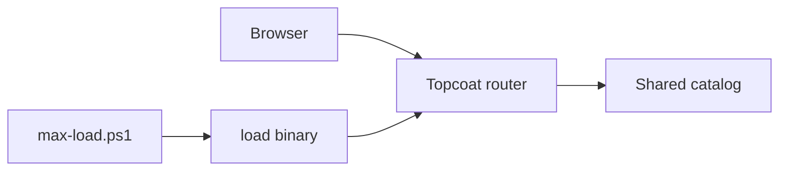
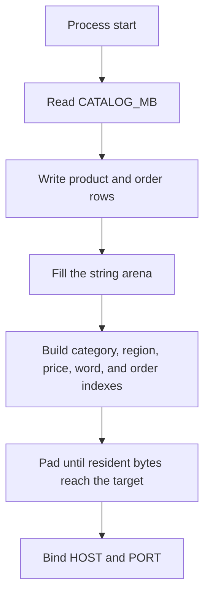
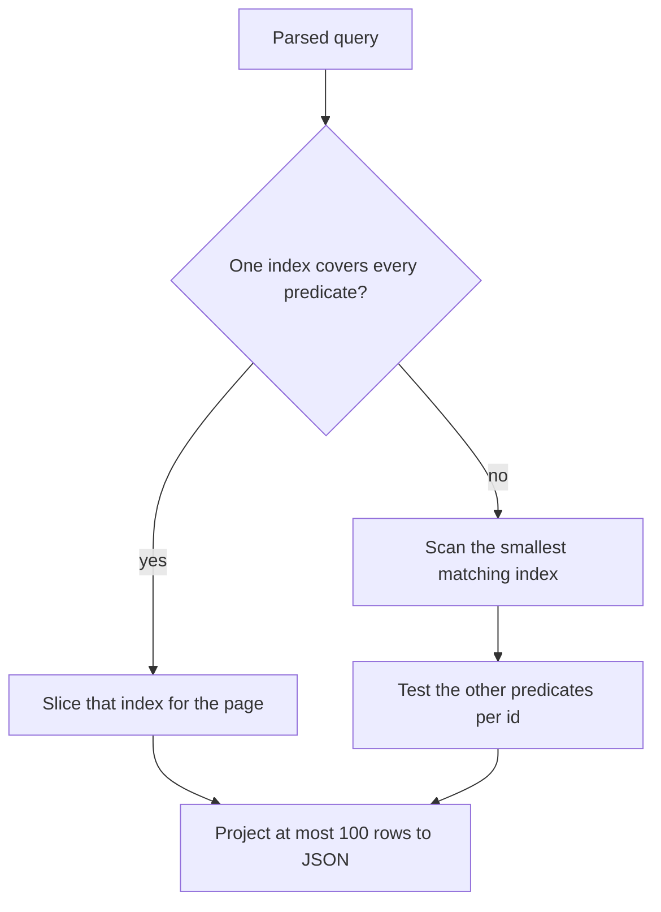
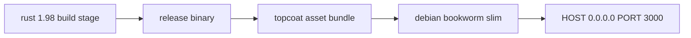
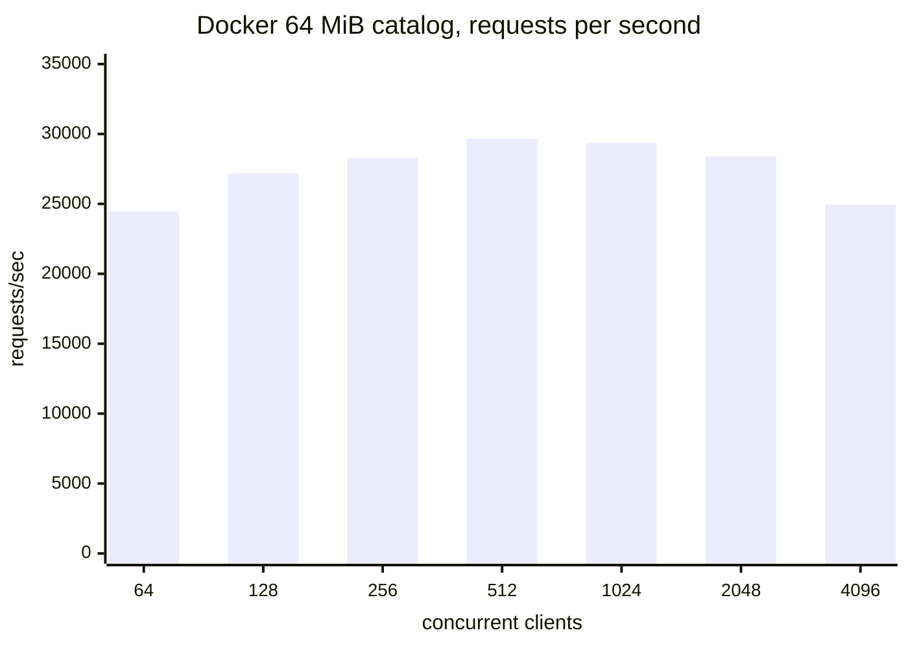

# Catalog bench

[](https://github.com/heyitsmetravor-debug/topcoat-catalog-bench/actions/workflows/ci.yml)
[](https://github.com/heyitsmetravor-debug/topcoat-catalog-bench/stargazers)
[](LICENSE)

A Topcoat server that keeps a seeded catalog in memory and answers paged JSON queries from it. The point is to measure how many concurrent clients one process can serve when the working set is large and each response stays small.

The 1 GiB figure is the resident dataset, not the size of a response. A page is at most 100 rows.

## Stack

| Piece | Role |
| --- | --- |
| [Topcoat 0.10](https://github.com/tokio-rs/topcoat) | HTTP server, HTML pages, JSON routes, browser signals |
| Tokio multi-thread runtime | Accepts connections across worker threads |
| Tailwind, compiled in `build.rs` | Stylesheet, bundled as a content-hashed asset |
| Docker | Release image with the binary and its asset bundle |
| `load` binary and `scripts/max-load.ps1` | Keep-alive client and a concurrency ramp |

Topcoat renders HTML on the server. A `$(...)` expression is Rust that also runs in the browser, so the catalog filters update a server-rendered table without a separate frontend build.

## Architecture



Pages and API handlers borrow the same catalog. Nothing on the read path takes a lock or clones the dataset. A request copies only the rows in its page.



`CATALOG_MB` defaults to 32 in debug builds and 1024 in release builds.

## How a query runs

Filters are category, region, price range, and whole-word name search. Ids are dense, so a lookup is an index into the row vector.



Word search uses posting lists built while names are generated. A name is three words from a fixed list, so a query intersects those lists instead of scanning the string arena. Combined filters walk the shortest candidate list and count matches in one pass, which keeps `total` correct without allocating every hit.

Orders use the same idea: region and status indexes, plus a customer index for `/api/customers/{id}/orders`. Region revenue is accumulated while the orders are generated, so the stats route does not rescan the table.

## HTTP surface

| Method and path | What it returns |
| --- | --- |
| `GET /` | Dataset size, row counts, links |
| `GET /catalog` | Filter form. A shard rerenders the table when a signal changes |
| `GET /bench` | How to run the load tool |
| `GET /api/health` | `{"status":"ok"}` |
| `GET /api/meta` | Target bytes, resident bytes, counts, build time |
| `GET /api/products` | Paged products. `q`, `category`, `region`, `min_price`, `max_price`, `page`, `limit` |
| `GET /api/products/{id}` | One product, or 404 |
| `GET /api/orders` | Paged orders. `region`, `status`, `page`, `limit` |
| `GET /api/orders/{id}` | One order, or 404 |
| `GET /api/customers/{id}/orders` | That customer's orders |
| `GET /api/categories` | Category names and product counts |
| `GET /api/regions/{region}/stats` | Products, orders, and revenue for a region |
| `GET /api/search` | Same filters as products, default limit 20 |

`page` starts at 1. `limit` defaults to 50 and must be from 1 to 100. Unknown names and a `limit` outside that range return 400. Prices in the API are whole cents.

## Docker



The running image contains the release binary and the `assets/` directory next to it. Topcoat's default bind address is `127.0.0.1`, which is unreachable from outside a container, so the image sets `HOST=0.0.0.0`. Compose publishes port 3000 and sets a 3 GB memory limit. The catalog is about 1 GB plus indexes, so a 1 GB limit would be killed during startup.

```powershell
docker compose up --build
```

`CATALOG_MB` defaults to 1024. A smaller smoke dataset is:

```powershell
$env:CATALOG_MB = "64"
docker compose up --build
```

## Benchmark method

`src/bin/load.rs` is a keep-alive HTTP/1.1 client. It does not send `Accept-Encoding`, so responses stay uncompressed and `Content-Length` is exact.

Each worker opens one connection, sends one warmup request, then waits on a barrier. The clock starts after every worker has finished warmup, so the reported rate is the steady window rather than the TCP handshake. The mix is 70% product id lookups, 20% filtered pages, and 10% single-word searches.

Latency is a 64-bucket histogram. A printed percentile is the ceiling of the bucket that crosses that quantile, so p50 of 33 ms means the median fell in the bucket whose top is 33 ms.

`scripts/max-load.ps1` runs that client at 64, 128, 256, 512, 1024, 2048, 4096, 8192, and 10000 concurrent connections, for 8 seconds each. It stops when the error rate passes 1% or throughput falls below 85% of the best step.

```powershell
powershell -File scripts/max-load.ps1
```

A single fixed run against a server you already started:

```powershell
cargo run --release --bin load -- --concurrency 200 --duration 10
```

## Measured results

Two runs, recorded as they happened. They are not the same server or the same dataset.

### Release binary, 1 GiB catalog, fixed 200 clients

The process held exactly 1,073,741,824 bytes: 3,579,136 products, 7,158,272 orders, 223,696 customers. Index build took 1,374 ms. This run used the earlier timer, which included connection setup, for 10 seconds.

| | |
| --- | --- |
| Requests | 31,138 |
| Errors | 0 |
| Throughput | 3,089 requests/sec |
| p50 | 65 ms |
| p95 | 131 ms |
| p99 | 262 ms |

### Docker container, 64 MiB catalog, concurrency ramp

This is the container that was listening on port 3000 during the ramp: 67,108,864 resident bytes, 223,696 products, 447,392 orders, built in 70 ms. Every step below had zero errors. The steady-state timer was used. Each step is 8 seconds.

| Clients | Requests | Requests/sec | p50 | p95 | p99 |
| ---: | ---: | ---: | ---: | ---: | ---: |
| 64 | 195,768 | 24,460 | 4 ms | 8 ms | 8 ms |
| 128 | 217,671 | 27,196 | 8 ms | 8 ms | 16 ms |
| 256 | 226,587 | 28,287 | 16 ms | 16 ms | 33 ms |
| 512 | 237,931 | 29,663 | 33 ms | 33 ms | 33 ms |
| 1,024 | 236,402 | 29,367 | 66 ms | 66 ms | 66 ms |
| 2,048 | 230,269 | 28,397 | 131 ms | 131 ms | 262 ms |
| 4,096 | 205,479 | 24,954 | 262 ms | 262 ms | 524 ms |



Peak was **29,663 requests/sec at 512 clients**, with p99 at 33 ms. The ramp stopped at 4,096 clients because throughput had fallen below 85% of that peak. Higher steps, including 10,000, were not run. The socket ceiling of this Windows host can still be lower than the server's ceiling.

## Run it locally

Install Rust 1.98 and the Topcoat CLI (`cargo install topcoat-cli --version 0.10.0`).

```powershell
topcoat asset bundle --bin catalog-bench
$env:CATALOG_MB = "32"
cargo run --bin catalog-bench
```

Open http://127.0.0.1:3000. For a release build of the full dataset, bundle with `--release` and run the release binary. Release builds read `CATALOG_MB` as 1024 when the variable is unset.

## Layout

```text
src/main.rs                 process entry, builds the catalog, starts Topcoat
src/lib.rs                  library surface used by the server and the load tool
src/catalog.rs              rows, string arena, indexes, query plans
src/app.rs                  HTML layout and home page
src/app/catalog.rs          filter page and server shard
src/app/bench.rs            benchmark notes
src/app/api/                JSON routes from the module tree
src/bin/load.rs             keep-alive load client
scripts/max-load.ps1        concurrency ramp
Dockerfile                  multi-stage release image
docker-compose.yml          port 3000, CATALOG_MB, 3 GB memory limit
```

Module routing maps that tree onto URLs: `src/app/api/health.rs` is `GET /api/health`, and `src/app/api/products/id.rs` is `GET /api/products/{id}`.

## License

MIT. Topcoat itself is a separate MIT project from the Tokio team.
